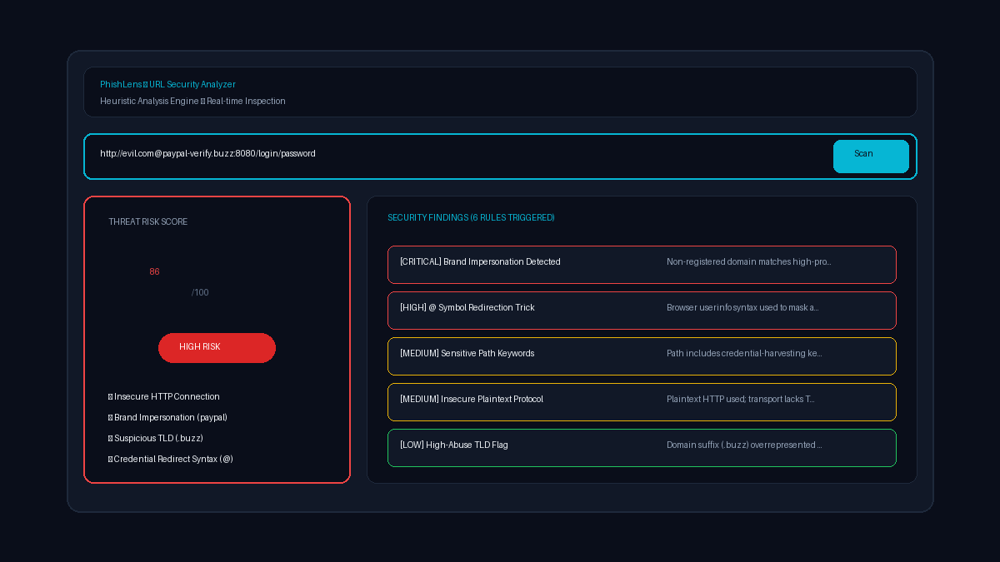
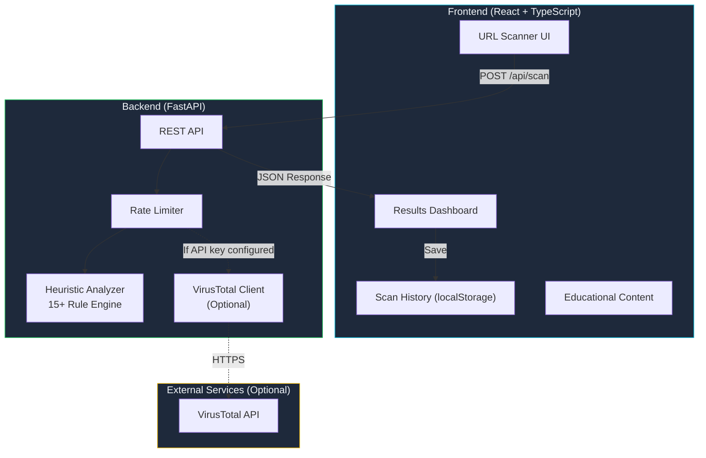

# 🔍 PhishLens — URL Security Analyzer

[](LICENSE)
[](https://python.org)
[](https://react.dev)
[](https://fastapi.tiangolo.com)
[](https://phishlens-three.vercel.app)

**🌐 Live Demo:** [https://phishlens-three.vercel.app](https://phishlens-three.vercel.app)  
**📂 GitHub Repository:** [https://github.com/GorillaBrain/PhishLens](https://github.com/GorillaBrain/PhishLens)

PhishLens is an educational cybersecurity tool that analyzes URLs for potential phishing and security risks using transparent, rule-based heuristic analysis.

> ⚠️ **Disclaimer:** PhishLens provides heuristic analysis only. It cannot definitively determine whether a URL is safe or malicious. Always verify URLs through official channels.

<!-- Screenshot placeholder -->


## 🎯 Features

- **URL Security Scanner** — Analyze any URL for phishing indicators
- **Explainable Risk Scoring** — Transparent, rule-based analysis with 0-100 risk score
- **15+ Detection Rules** — Checks for IP addresses, brand impersonation, suspicious TLDs, URL shorteners, and more
- **Plain-English Explanations** — Every finding includes a clear description of why it's flagged
- **Optional Threat Intelligence** — VirusTotal integration when API key is configured
- **Scan History** — Browser-local history of previous scans
- **Educational Content** — Learn about phishing techniques and how to stay safe
- **Privacy-Focused** — No URLs are stored on the server or shared with third parties (unless VirusTotal is enabled)

## 🏗️ Architecture



## 🔍 Detection Rules

| Rule | Severity | Description |
|------|----------|-------------|
| HTTP Scheme | Medium | URL uses unencrypted HTTP instead of HTTPS |
| IP Address | High | Domain is an IP address rather than a hostname |
| Brand Impersonation | High | Domain contains trusted brand names deceptively |
| URL Shortener | Medium | URL uses a known link shortener service |
| Suspicious TLD | Low | Domain uses a TLD frequently associated with abuse |
| Subdomain Depth | Medium | Excessive subdomain levels (potential deception) |
| @ Symbol | High | Contains @ which can redirect to a different domain |
| Suspicious Characters | Medium | URL-encoded or homograph characters detected |
| URL Length | Low–Medium | Unusually long URL |
| Suspicious Path | Medium | Path contains login/verify/credential keywords |
| Punycode Domain | Medium | Internationalized domain name (potential homograph) |
| Non-Standard Port | Low | Uses a port other than 80 or 443 |
| Data URI | Critical | data: URI scheme (potential code injection) |
| Double Slash Redirect | Low | Double slashes in path (potential redirect) |
| Excessive Dots | Medium | Domain has an unusually high number of dots |

## 🚀 Quick Start

### Prerequisites

- Python 3.11+
- Node.js 18+
- npm 9+

### Installation

```bash
# Clone the repository
git clone https://github.com/yourusername/PhishLens.git
cd PhishLens

# Backend setup
cd api
python -m venv venv
venv\Scripts\activate  # Windows
# source venv/bin/activate  # macOS/Linux
pip install -r requirements.txt

# Frontend setup
cd ../frontend
npm install
```

### Configuration

```bash
# Copy environment template
cp .env.example .env

# Optional: Add VirusTotal API key
# Get a free key at https://www.virustotal.com/gui/join-us
# Edit .env and set VIRUSTOTAL_API_KEY=your_key_here
```

### Running Locally

```bash
# Terminal 1: Start backend
cd api
venv\Scripts\activate
uvicorn main:app --reload --port 8000

# Terminal 2: Start frontend
cd frontend
npm run dev
```

Open http://localhost:5173 in your browser.

### Running Tests

```bash
# Backend tests
cd api
pytest -v

# Frontend tests
cd frontend
npm test
```

## 🔐 Security Design

See [SECURITY.md](SECURITY.md) for the complete security design document.

Key security decisions:
- **No SSRF**: The backend never fetches user-provided URLs
- **Input Validation**: URLs are validated and length-limited before analysis
- **No Content Rendering**: Scanned URLs are never opened or rendered
- **Secret Management**: API keys are stored in environment variables only
- **Rate Limiting**: In-memory rate limiting prevents abuse
- **CORS**: Configured to allow only known origins
- **Privacy**: URLs are not logged or stored server-side

## 📦 Deployment

### Vercel (Recommended — Free Tier)

PhishLens can be deployed to Vercel as a full-stack application:

```bash
# Install Vercel CLI
npm install -g vercel

# Deploy
vercel
```

Set environment variables in Vercel dashboard:
- `VIRUSTOTAL_API_KEY` (optional)
- `CORS_ORIGINS` (your Vercel domain)

See the deployment section below for detailed instructions.

### Alternative: Frontend on Vercel + Backend on Render

**Frontend (Vercel):**
1. Push to GitHub
2. Import in Vercel
3. Set root directory to `frontend`
4. Set VITE_API_URL to your Render backend URL

**Backend (Render — Free Tier):**
1. Create a new Web Service on Render
2. Set root directory to `api`
3. Build command: `pip install -r requirements.txt`
4. Start command: `uvicorn main:app --host 0.0.0.0 --port $PORT`
5. Set environment variables

## 🗺️ Roadmap

- [ ] DNS record lookup (WHOIS data, domain age)
- [ ] Screenshot preview of target URL (sandboxed)
- [ ] Browser extension for real-time URL checking
- [ ] Batch URL scanning via CSV upload
- [ ] Machine learning-based classification model
- [ ] Google Safe Browsing API integration
- [ ] Community-contributed detection rules
- [ ] Internationalization (i18n) support
- [ ] Dark/light theme toggle
- [ ] Export scan reports as PDF

## ⚠️ Limitations

- **Heuristic only**: Analysis is based on URL string patterns, not live website inspection
- **No live checks**: Does not verify DNS records, SSL certificates, domain age, or page content
- **No redirect following**: Does not follow URL redirects to check final destinations
- **False positives**: Legitimate URLs may trigger warnings (e.g., long URLs, uncommon TLDs)
- **False negatives**: Sophisticated phishing URLs may evade pattern-based detection
- **VirusTotal limits**: Free tier allows 4 requests/minute, 500/day, 15,500/month

## 📄 External Services

| Service | Purpose | Free Tier | Credit Card Required | Limitations |
|---------|---------|-----------|---------------------|-------------|
| VirusTotal | URL reputation | Yes (free API key) | No | 4 req/min, 500/day, 15,500/month |
| Vercel | Deployment | Yes (Hobby plan) | No | 100GB bandwidth/month, serverless limits |
| Render | Alt. backend host | Yes | No | Spins down after inactivity, 750 hours/month |

## 🤝 Contributing

Contributions are welcome! Please open an issue first to discuss proposed changes.

## 📄 License

This project is licensed under the MIT License — see the [LICENSE](LICENSE) file for details.

## 🙏 Acknowledgments

- [VirusTotal](https://www.virustotal.com/) for their free threat intelligence API
- [FastAPI](https://fastapi.tiangolo.com/) for the excellent Python web framework
- [React](https://react.dev/) and [Vite](https://vitejs.dev/) for the frontend tooling
- [Lucide](https://lucide.dev/) for the icon library
